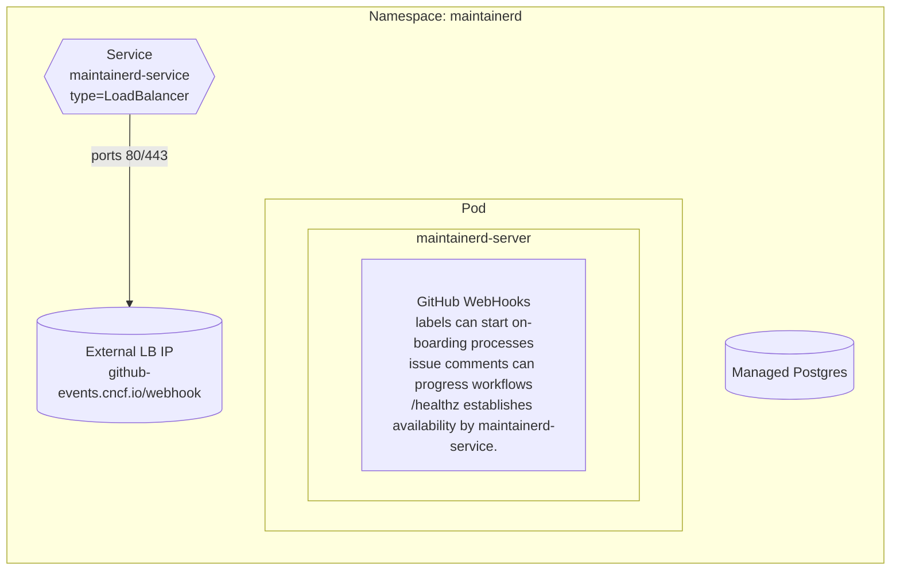
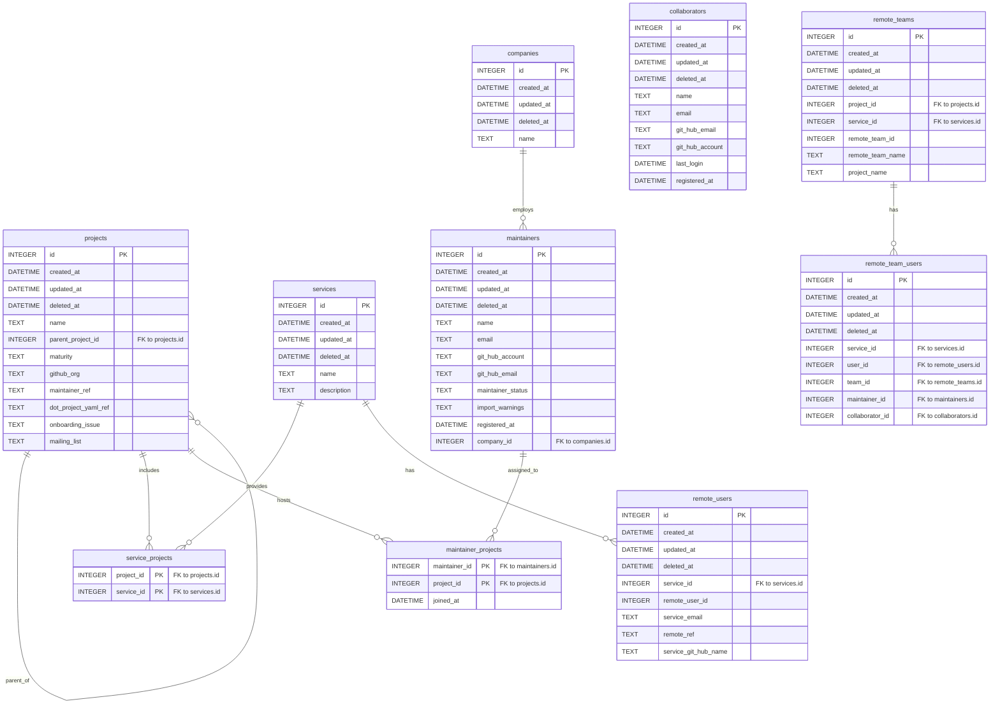

# Deployment notes

MaintainerD - input data (List of Projects and associated Maintainers) 

## Web build-time env
The web image build reads `NEXT_PUBLIC_BFF_BASE_URL` from
`deploy/secrets/maintainerd-web-env.yaml` if it is not already set in the
environment. This ensures production builds bake the correct base URL. To
override, export `NEXT_PUBLIC_BFF_BASE_URL` before running `make web-image-build`
or `make web-image-push`.

## Kubernetes resources overview



    deploy -->|creates| pod
    deploy -->|connects| pg
    deploy -->|envFrom| secrets
    deploy -->|imagePullSecrets| ghcr
    pod -->|exposes 2525| svc
    svc -->|TLS| tls


## Maintainer Database ER diagram




## Manifest layout
 - `deploy/manifests/` holds only long-lived resources (Deployments, Services, Ingresses, CronJobs, cert-manager objects, the ServiceAccount). `make manifests-apply` applies the whole directory with `kubectl apply -k` and is safe to re-run.
 - `deploy/manifests/kustomization.yaml` pins the image tag of every workload. `make image-set TAG=<tag>` rewrites those tags and applies; commit the file afterwards. See "Release new images" in `OPS.MD`.
 - `deploy/jobs/` holds one-shot Jobs (schema migration, backfills, add-staff, profile sync). Apply them one file at a time, on purpose. See `deploy/jobs/README.md`.
 - The Google-worksheet `bootstrap` Job was retired. A possible replacement that discovers `.project` repos across the CNCF org is tracked in #181.

## GitHub Event Listener

### cert-manager
Manages the server cert associated with the maintainer-d event listener that listens for changes to onboarding issues.

Steps to integrate with Let's Encrypt on OKE:

1. Create the OCI DNS credentials secret:
   ```bash
   kubectl create secret generic oci-dns-credentials -n cert-manager \
     --from-literal=tenancyOCID=<tenancy_ocid> \
     --from-literal=userOCID=<user_ocid> \
     --from-literal=fingerprint=<api_key_fingerprint> \
     --from-file=privateKey=<path_to_api_key_private_key_pem>
   ```
2. Apply a `ClusterIssuer` using the OCI DNS solver (update compartment OCID, DNS zone, and email):
   ```yaml
   apiVersion: cert-manager.io/v1
   kind: ClusterIssuer
   metadata:
     name: letsencrypt-dns
   spec:
     acme:
       email: you@example.com
       server: https://acme-v02.api.letsencrypt.org/directory
       privateKeySecretRef:
         name: letsencrypt-dns-account-key
       solvers:
       - dns01:
           oci:
             compartmentOCID: ocid1.compartment.oc1..aaaaaaaa22icap66vxktktubjlhf6oxvfhev6n7udgje2chahyrtq65ga63a
             dnsZoneName: cncf.io.
             secretRef:
               name: oci-dns-credentials
               key: privateKey
             tenancyOCID: ocid1.tenancy.oc1...            # must match the secret
             userOCID: ocid1.user.oc1...                  # must match the secret
             fingerprint: <api_key_fingerprint>
   ```
3. Request the certificate in the `maintainerd` namespace:
   ```yaml
   apiVersion: cert-manager.io/v1
   kind: Certificate
   metadata:
     name: maintainerd-cert
     namespace: maintainerd
   spec:
     secretName: maintainerd-tls
     issuerRef:
       name: letsencrypt-dns
       kind: ClusterIssuer
     dnsNames:
     - github-events.cncf.io
   ```
4. Update `deploy/manifests/service.yaml` to expose HTTPS and reference the secret:
   ```yaml
   metadata:
     annotations:
       service.beta.kubernetes.io/oci-load-balancer-ssl-ports: https
       service.beta.kubernetes.io/oci-load-balancer-tls-secret: maintainerd/maintainerd-tls
   spec:
     ports:
     - name: http
       port: 80
       targetPort: 2525
     - name: https
       port: 443
       targetPort: 2525
   ```
5. Apply the manifests (`kubectl apply -f deploy/manifests/service.yaml`) and verify:
   - `kubectl describe certificate maintainerd-cert -n maintainerd`
   - `kubectl get secret maintainerd-tls -n maintainerd`
   - `curl -vk https://github-events.cncf.io/healthz`

Ensure your OCI IAM policies allow the OKE dynamic group to manage DNS records in the relevant compartment; otherwise the ACME solver cannot create the TXT challenges.
